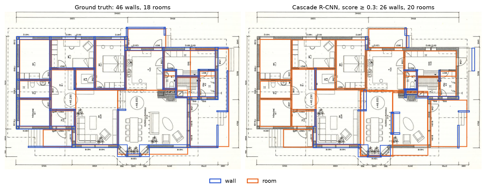
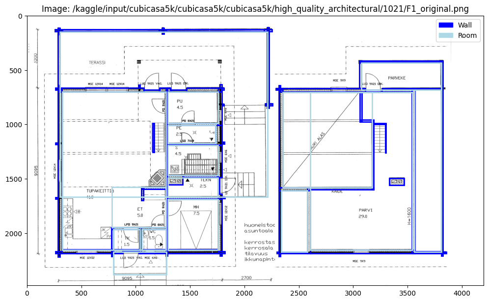
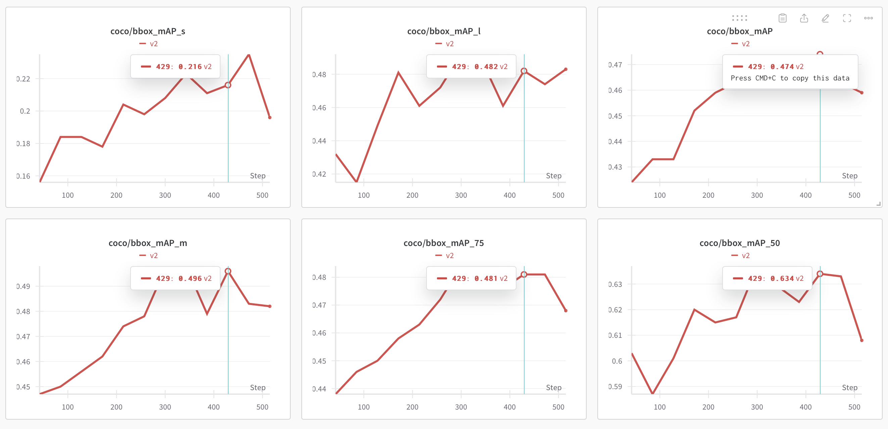

# Floor plan detection

Finds walls and rooms in floor plan images: MMDetection models fine-tuned on CubiCasa5k, served by a small FastAPI app.



*A plan from the CubiCasa5k test split: ground truth on the left, the Cascade R-CNN model on the right (detections with
confidence of at least 0.3). Made with `notebooks/inference_and_visualization.ipynb`.*

Training notebook on Kaggle: [CubiCasa5k | Swin Transformer [MMDetection]](https://www.kaggle.com/code/qmarva/cubicasa5k-swin-transformer-mmdetection)
(data preparation, model configs and training commands).

## What it does

The API takes an image of a floor plan, cropped to the drawing, and returns two lists of axis-aligned bounding boxes
with confidences: walls and rooms. A wall is one wall segment as annotated in CubiCasa5k. A room is one connected room
region, and outdoor areas such as balconies and terraces count as rooms.

Boxes are a coarse description of a plan. They are enough to count rooms, find their extents and locate wall
segments, but they do not give wall centre lines, thickness or room polygons.

## Approach

**Data.** CubiCasa5k has 5,000 floor plan images with SVG polygon annotations in more than 80 categories. The
notebook `notebooks/cubicasa5k_to_coco.ipynb` turns them into COCO boxes with two classes. Each wall instance in the SVG
becomes a `wall` box. For rooms, the notebook takes the room segmentation map, finds its connected regions and keeps
those labelled as a room type (outdoor, kitchen, living room, bedroom, bath, entry, storage, garage, undefined).
Boxes are in the pixel coordinates of the original images. The dataset's own split gives:

| Split | Images | Wall boxes | Room boxes |
|---|---:|---:|---:|
| train | 4,200 | 123,350 | 49,673 |
| val | 400 | 11,320 | 4,606 |
| test | 400 | 11,985 | 4,833 |



*Converted annotations on a training image: walls in dark blue, rooms in light blue.*

Walls are long and thin, so many wall boxes are small: 62,624 of the 123,350 training wall boxes have an area under
32×32 pixels, the COCO "small" size. Only 1,263 room boxes are that small.

**Models.** Three detectors from MMDetection 3.3, each fine-tuned from its COCO-pretrained checkpoint:

| `--model` | Detector | Backbone |
|---|---|---|
| `cascade_swin` | Cascade R-CNN | ResNet-101 + FPN |
| `faster_rcnn` | Faster R-CNN | ResNet-50 + FPN |
| `retinanet` | RetinaNet | ResNet-50 + FPN |

Cascade R-CNN refines its boxes in three stages trained at rising IoU thresholds (0.5, 0.6, 0.7). For thin wall boxes,
where a few pixels of error change the IoU a lot, that extra localisation step is the reason to try it. The name
`cascade_swin` is historical and kept because the published weights file uses it: the model has a ResNet-101
backbone, not a Swin Transformer. The Kaggle notebook also defines a Faster R-CNN with a Swin-T backbone, but I have no
saved results from it, so it is not part of the comparison.

**Training.** All three models were trained in Kaggle notebooks with the same recipe: images resized to fit 1333×800,
random horizontal flips, batch size 2, SGD with momentum 0.9 and weight decay 0.0001, learning rate 0.02 (0.01 for
RetinaNet) after a 500-iteration linear warm-up, and COCO box AP on the validation split after every epoch. The configs
are in `configs/`.

Before training detectors I tried DeepFloorplan, a segmentation model for plans (`notebooks/deepfloorplan_model.ipynb`).
In my tests its wall and room masks were noisy and broken up, so I moved to box detection.

## Results

COCO box AP on the 400 validation images. The numbers come from the training logs that MMEngine stores inside each
published checkpoint; for Cascade R-CNN they match the W&B chart below.

| Model | Epochs trained | Best epoch | AP | AP50 | AP75 | AP small | AP medium | AP large |
|---|---|---:|---:|---:|---:|---:|---:|---:|
| Cascade R-CNN | 12 of 24 planned | 10 | 0.474 | 0.634 | 0.481 | 0.216 | 0.496 | 0.482 |
| RetinaNet | 3 of 12 planned | 2 | 0.420 | 0.670 | 0.407 | 0.169 | 0.449 | 0.461 |
| Faster R-CNN | 8 of 12 planned | | not measured | | | | | |

Cascade R-CNN gives the best AP and AP75, so it is the default model. RetinaNet reached a higher AP50 after only two
epochs, which suggests it finds the objects but places the boxes less precisely. Small boxes, which are almost all walls
(6,104 of the 6,214 small validation boxes), are the weak point for both.



*Validation AP of the Cascade R-CNN run in Weights & Biases. The x axis is the W&B logging step; the 12 points are
epochs 1 to 12, and the highlighted one is epoch 10.*

Some caveats about these numbers:

- All three runs stopped early, before any learning-rate decay step, so none of the models finished its schedule.
- The published checkpoints are the last saved epochs, not the best ones: epoch 12 for Cascade R-CNN (its score is
  the last point of the chart, below the epoch 10 peak), epoch 3 for RetinaNet (its evaluation is not in the logs) and
  epoch 8 for Faster R-CNN.
- The Faster R-CNN run logged an AP of 0.000 after every epoch because its validation evaluator pointed to the test
  annotations while the loader read validation images. The config here is fixed and the checkpoint produces sensible
  boxes, but its accuracy has not been measured.
- The test split has not been evaluated for any model.

## How to run

### 1. Get the code and the weights

```shell
git clone --recurse-submodules https://github.com/xmarva/floorplan-detection.git
cd floorplan-detection
```

In an existing clone, run `git submodule update --init`. Both submodules use https URLs. The server and training need
only `mmdetection` (the configs inherit its base files); `data/CubiCasa5k` holds the dataset code used by the conversion
notebook.

Download the checkpoints from the [model weights folder on Google Drive](https://drive.google.com/drive/folders/1MgW3Qo-8K4OrHi4ebvYd-81cTqQxwLgz?usp=sharing)
into `weights/`, keeping the file names: `cascade_swin_latest.pth` (712 MB), `faster_rcnn_latest.pth` (333 MB) and
`retinanet_latest.pth` (291 MB). The files also contain the optimizer state, which is why they are large.

### 2. Start the server

With Python 3.10 or 3.11, install PyTorch and the matching mmcv wheel, then the rest:

```shell
pip install torch==2.1.2 torchvision==0.16.2
pip install mmcv==2.1.0 -f https://download.openmmlab.com/mmcv/dist/cu121/torch2.1/index.html  # .../cpu/torch2.1/... without CUDA
pip install -r requirements.txt
python run.py --model cascade_swin
```

The server loads the model once and listens on port 5000. Options: `--checkpoint` (default
`weights/<model>_latest.pth`), `--device` (default `cuda:0` when available, else `cpu`), `--score-threshold` (default
0.3; 0 returns everything the model outputs), `--host` and `--port`. The model itself already drops scores below 0.05
and keeps at most 100 boxes per image. On an Apple M2 CPU, Cascade R-CNN takes about 2 seconds per plan image.

Or with Docker. The image holds the code and dependencies; the weights are mounted from `weights/`:

```shell
docker build -t floorplan-detection .
docker run --rm --gpus all -p 5000:5000 -v "$PWD/weights:/app/weights" floorplan-detection
docker run --rm -p 5000:5000 -v "$PWD/weights:/app/weights" floorplan-detection --model retinanet --device cpu
```

Arguments after the image name replace the default `--model cascade_swin`.

### 3. Call the API

Send the image as the multipart field `image` (JPEG or PNG, up to 10 MB):

```shell
curl -X POST "http://localhost:5000/run-inference" \
     -H "Content-Type: multipart/form-data" \
     -F "image=@/path/to/plan.png"
```

The response for a CubiCasa5k test plan (15 walls and 19 rooms; lists shortened, numbers rounded):

```json
{
  "type": "floor_plan",
  "confidence": 0.7153,
  "detectionResults": {
    "walls": [
      {
        "id": "wall_1",
        "position": {"start": {"x": 614.93, "y": 538.94}, "end": {"x": 748.64, "y": 551.62}},
        "confidence": 0.9742
      }
    ],
    "rooms": [
      {
        "id": "room_1",
        "position": {"start": {"x": 116.02, "y": 280.13}, "end": {"x": 165.93, "y": 337.13}},
        "confidence": 0.991
      }
    ]
  }
}
```

`start` and `end` are the top-left and bottom-right corners of a box, in pixels of the uploaded image. For a wall they
are the corners of its bounding box, not the ends of its centre line. Ids are numbered per class in order of
decreasing confidence. The top-level `confidence` is the mean confidence of the returned boxes, or 0 when there are
none.

Errors come back as `{"detail": "..."}`: 400 if the image cannot be decoded, 413 if it is larger than 10 MB, 415 if it
is not JPEG or PNG, 422 if the `image` field is missing and 500 if inference fails. `GET /health` reports the loaded
model and device, and `/docs` has the OpenAPI page.

## Train or evaluate a model

The configs read the data from the Kaggle dataset [qmarva/cubicasa5k](https://www.kaggle.com/datasets/qmarva/cubicasa5k),
where the models were trained, and log to Weights & Biases. Install PyTorch and mmcv as in step 2, then, on Kaggle,
from the repository root:

```shell
pip install -r requirements-notebooks.txt
python mmdetection/tools/train.py configs/cascade_swin.py
python mmdetection/tools/test.py configs/cascade_swin.py weights/cascade_swin_latest.pth
```

On another machine, put the images in `data/CubiCasa5k/data/cubicasa5k/` and the annotation files in
`data/cubicasa5k_coco/`. The annotation files store absolute Kaggle image paths, so rewrite them (with GNU sed; on
macOS use `sed -i ''`):

```shell
sed -i 's#/kaggle/input/cubicasa5k/cubicasa5k/cubicasa5k/#data/CubiCasa5k/data/cubicasa5k/#' data/cubicasa5k_coco/*_coco_pt.json
```

Then set `data_root = ''` and `ann_dir = 'data/cubicasa5k_coco/'` at the top of the config and run the same commands
from the repository root. A new model needs a new config in `configs/` and an entry in `MODELS` in `run.py`.

## Repository layout

```
run.py                     FastAPI inference server
configs/                   MMDetection configs: cascade_swin.py, faster_rcnn.py, retinanet.py
notebooks/
  cubicasa5k_to_coco.ipynb           CubiCasa5k SVG annotations to COCO boxes
  inference_and_visualization.ipynb  ground truth vs. prediction on a test image
  deepfloorplan_model.ipynb          DeepFloorplan segmentation baseline
examples/                  figures used in this README
mmdetection/               submodule: MMDetection 3.3.0 (base configs, train and test tools)
data/CubiCasa5k/           submodule: CubiCasa5k code; images go to data/CubiCasa5k/data/
data/cubicasa5k_coco/      COCO annotation files (downloaded, not tracked)
weights/                   checkpoints (downloaded, not tracked)
Dockerfile                 inference image
requirements.txt           server dependencies; requirements-notebooks.txt adds training and notebook packages
```

## Data

[CubiCasa5k](https://github.com/CubiCasa/CubiCasa5k) (Kalervo et al., 2019) is available from
[Zenodo](https://zenodo.org/records/2613548) under the CC BY-NC 4.0 license, which allows non-commercial use only.
Extract it into `data/CubiCasa5k/data/`.

The COCO annotations made by the conversion notebook (`train_coco_pt.json`, `val_coco_pt.json`,
`test_coco_pt.json`) are in the Kaggle dataset [qmarva/cubicasa5k](https://www.kaggle.com/datasets/qmarva/cubicasa5k),
next to a copy of the images, and in a [Google Drive folder](https://drive.google.com/drive/folders/1hKRWrP-ZKk6ZHrjHOSRSxPe_r_kMd8uh?usp=sharing).
Put them in `data/cubicasa5k_coco/`.

## Notes and limitations

The models have seen only CubiCasa5k, which is residential floor plans. Architectural drawings from other sources,
with different line weights, hatching, dimension chains and title blocks, are outside what they saw in training, and
the API assumes the image is already cropped to the plan.

The configs keep at most 100 boxes per image, MMDetection's default. Seven of the 400 validation plans have more
objects than that (up to 208), so on large plans the lowest-scoring boxes are lost. Raising `max_per_img` in the
config's `test_cfg` changes that.

Boxes fit walls and rooms poorly when they are not axis-aligned. A diagonal wall gets a large box that covers the
space around it, and the box of an L-shaped room overlaps its neighbours. Instance masks or polygons would describe
plans better; the CubiCasa5k annotations contain them, but the conversion keeps only boxes.

The obvious next steps are to finish the training schedules, keep the best epoch rather than the last, measure Faster
R-CNN, and report results on the test split.
